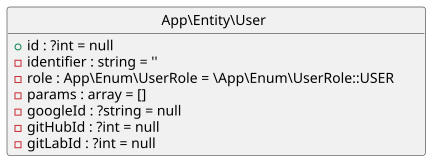

# Symfony Playground "two"


## What's this??
An opinionated [Symfony](https://symfony.com) project template including:

* Symfony 8.*
* Docker compose file for PostgreSQL
* `dev` login form <br/> `prod` Social login with Google, GitLab, GitHub and [more](https://github.com/knpuniversity/oauth2-client-bundle#step-1-download-the-client-library)
* A user CRUD interface
* Bootstrap

## Google login: pick one

The template ships **two** Google logins so you can choose. Both store the same Google account ID in `User::$googleId`, so users keep their accounts whichever one you keep. **Remove the one you don't need.**

| | OAuth redirect | Sign in with Google |
|---|---|---|
| Authenticator | `GoogleAuthenticator` | `GoogleIdentityAuthenticator` |
| How it works | Redirects to Google and back, like the GitHub login (via `knpuniversity/oauth2-client-bundle`) | Google's own button / One Tap ([Google Identity Services](https://developers.google.com/identity/gsi/web)), posts an ID token to `/connect/google/verify` |
| Choose it if | You also need access to Google APIs, or want all providers to work the same way | You only need sign-in. This is what Google recommends, and the button follows Google's branding rules automatically |
| Extra dependencies | none | `google/apiclient` |

### Removing the OAuth redirect login
* Delete `src/Security/GoogleAuthenticator.php`, `src/Controller/Security/GoogleController.php` and `tests/Security/GoogleAuthenticatorTest.php`.
* Remove `App\Security\GoogleAuthenticator` from `custom_authenticators` in `config/packages/security.yaml`.
* Remove the `google` client from `config/packages/knpu_oauth2_client.yaml`, and `OAUTH_GOOGLE_SECRET` from `.env`.
* Remove the `connect_google_start` button from `templates/auth/login.html.twig`.
* Remove `Security/GoogleController.php` from `$ignoredFiles` in `tests/Controller/ControllerAccessTest.php`.
* Keep `league/oauth2-google`: `GoogleIdentityAuthenticator` uses its `GoogleUser` class.

### Removing the Sign in with Google login
* Delete `src/Security/GoogleIdentityAuthenticator.php`, `src/Controller/Security/GoogleIdentityController.php` and `tests/Security/GoogleIdentityAuthenticatorTest.php`.
* Remove `App\Security\GoogleIdentityAuthenticator` from `custom_authenticators` in `config/packages/security.yaml`.
* In `templates/auth/login.html.twig`, remove the `accounts.google.com/gsi/client` script and the `g_id_onload` / `g_id_signin` elements.
* Remove the `oauthGoogleId` argument from `src/Controller/Security/LoginFormController.php`.
* Run `composer remove google/apiclient` (its recipe removes `config/packages/google_apiclient.yaml` and the `GOOGLE_*` variables from `.env`).

Then run `make tests`.

## Installation
Clone the repo then use the
```shell
bin/install
```
command OR execute the script content manually.
   
## Usage
Create and administer user accounts.
```shell
symfony console user-admin
```
Start and stop the environment.
```shell
bin/start
```
```shell
bin/stop
```


## Testing

```shell
make tests
```

## Check for updates
Check four outdated PHP deps, recipes and assets.

```shell
composer check
```

## Database



You can create this with 

```shell
composer db-diagram
```

----

Happy coding `=;)`
